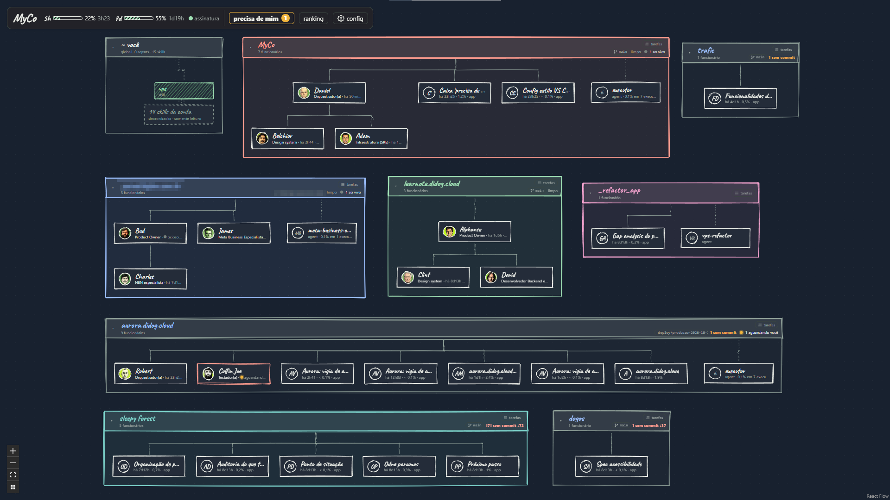
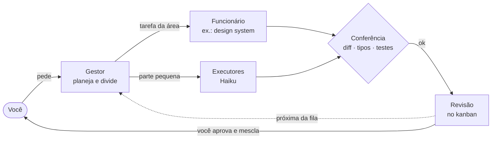
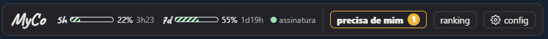
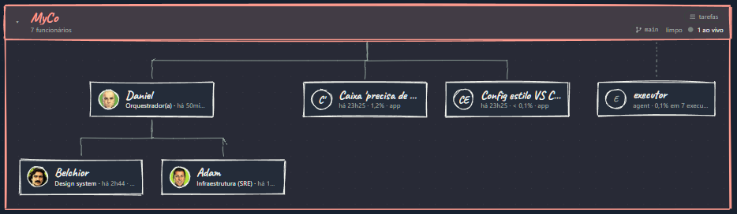
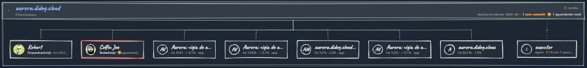

<div align="center">

# Claudio's Club

### Sua empresa de agentes do Claude Code, num quadro branco.

Contrate funcionários, passe tarefas, veja quem está trabalhando e quem está esperando por você.<br>
**Todos os seus projetos numa tela só**, rodando na sua máquina, com a sua assinatura.




</div>

---

## Dez terminais abertos. Qual deles está esperando você?

Quem usa o Claude Code a sério termina o dia com uma sessão por projeto, cada uma num terminal, cada uma com o seu contexto, e nenhuma visão do todo. O Claudio's Club transforma isso num escritório:

- **Cada projeto é uma sala**, com o organograma de quem trabalha nela.
- **Cada funcionário é uma sessão do Claude Code** com ficha, memória e autonomia que você define.
- **Um gestor planeja e distribui**, executores baratos fazem a parte braçal, e nada chega até você sem conferência.

## O que tem dentro

<table>
<tr>
<td width="33%" valign="top">

### 🏢 Escritório visual
Salas por projeto, organograma do gestor até a equipe, quem está ao vivo e o estado do git no cabeçalho: branch, arquivos sem commit, ↑↓ do remoto. Traço de caneta e letra de mão.

</td>
<td width="33%" valign="top">

### 👷 Funcionários com ficha
Cargo, missão, autonomia, modelo, agents, skills, MCPs, regras e definição de pronto. A ficha e a memória ficam em `.myco/` dentro do próprio projeto, com histórico de versões.

</td>
<td width="33%" valign="top">

### 🧭 Planeja grande, executa pequeno
O orquestrador quebra o trabalho e passa cada parte para quem é da área. Sozinho, escolhe o agent de cada parte: pesquisador e executor em Haiku, Sonnet quando a tarefa pede julgamento, revisor no que é arriscado. Um hook cobra a conferência de diff, tipos e testes a cada entrega.

</td>
</tr>
<tr>
<td valign="top">

### 💬 O app do Claude, aqui dentro
Modelo, esforço e autonomia na conversa (também nas sem ficha), `/` comandos e skills, `@` arquivos, prints e PDFs, lista de tarefas, voltar no tempo, duplicar conversa, trazer uma conversa aberta fora (vira cópia aqui), MCPs e agents em segundo plano.

</td>
<td valign="top">

### 📋 Kanban com fila
Uma tarefa por vez por funcionário: a próxima começa quando a atual vai para revisão. Cada um trabalha na sua worktree, e a entrega vira commit, com diff, testes e mesclar a um clique. A entrega volta para a conversa de quem pediu, já com os testes rodados. Opcional: o Codex dá uma segunda opinião na revisão, e o motor continua sendo o Claude.

</td>
<td valign="top">

### 🔔 Precisa de mim
Permissões, planos e as perguntas que o funcionário deixou no fim da resposta, numa caixa só, com o título da conversa, contador por aba, no título da página e notificação do sistema quando alguém termina.

</td>
</tr>
<tr>
<td valign="top">

### 📊 Consumo sob controle
Barras de 5 h e 7 dias da assinatura com o tempo até o reset, custo por funcionário, projeto e modelo, orçamento por projeto e uma linha de parada antes de estourar a cota.

</td>
<td valign="top">

### 🛡️ Guarda de segredos
Senha em comando, URL com senha e chaves conhecidas (Anthropic, OpenAI, GitHub, AWS, Stripe…) viram alerta no chat, nos comandos, nas saídas e no `.mcp.json` que vai para o git. O valor nunca é guardado, e "não é segredo" cala o alarme falso.

</td>
<td valign="top">

### ⚡ Simples ou Avançado
Começa no Simples: *Rápido / Equilibrado / Caprichado* e *Pede antes / Faz sozinho*. No Avançado, cada detalhe. E `Ctrl+K` leva a qualquer funcionário, tarefa ou conversa.

</td>
</tr>
<tr>
<td valign="top">

### 🗂️ Workspaces
Abas no topo para agrupar os projetos do seu jeito: por cliente, área, pessoal. Cada uma com cor e fundo próprios, e **+ projeto** cria uma pasta nova (com git) ou abre uma que já existe.

</td>
<td valign="top">

### 🔐 Servidores por projeto
A conexão SSH fica no projeto (host, usuário, caminho da chave, pasta remota), com botão de testar. Na ficha você marca quem acessa, e cada comando no servidor fica registrado.

</td>
<td valign="top">

### 🌎 Três idiomas e um demo
Interface em português, inglês e espanhol. O projeto demo traz uma cafeteria com equipe, hierarquia e tarefas prontas para você ver tudo funcionando sem gastar nada.

</td>
</tr>
</table>

## Como o trabalho anda



Quem pediu fica sabendo quando a parte dele termina. Funcionários que um gestor contrata entram como **temporários**: saem do quadro quando o trabalho acaba (arquivados, nada é apagado), e só você decide efetivar.

## De perto



**"Ainda posso pedir mais?"** A barra do topo mostra o uso da assinatura e quanto falta para o reset, quantas coisas esperam por você e o ranking: quem mais gastou (funcionários e agents), mais duas abas de modelos para código, por índice (de código; de inteligência, se a API não trouxer o de código) e por preço, com dados do Artificial Analysis.



**Uma sala, uma equipe.** O orquestrador no topo, quem é de cada área logo abaixo, as conversas soltas ao lado e os agents do projeto na coluna da direita.



**Quem trava, aparece.** O funcionário de testes pediu uma permissão: o cartão fica vermelho, a sala avisa "1 aguardando você" e o cabeçalho mostra um arquivo sem commit na branch de deploy.

## Por baixo do capô

- **O disco é a fonte da verdade.** O Claudio's Club grava o que o Claude Code já entende (`.claude/agents`, `.claude/skills`, `CLAUDE.md`) e as fichas em `<projeto>/.myco/`. Fechou o Claudio's Club, tudo continua funcionando.
- **Sem nuvem própria.** Cada funcionário é um processo `claude` na sua máquina, falando em `stream-json`. Conta, login e cota são os seus.
- **Só local.** O servidor escuta em `127.0.0.1`, recusa `Host` de fora (DNS rebinding) e só aceita escrita da própria página ou de ferramentas locais.
- **Infra com cinto de segurança.** O Claudio's Club gera o `ssh_config` de cada projeto sem senha (`BatchMode`), sem túneis nem repasse do agente; quem não tem acesso na ficha não roda `ssh`/`scp`, e `~/.ssh`, `.env` e a chave ficam bloqueados para o agente.

| Camada | Stack |
| --- | --- |
| Quadro | React 18, React Flow, Rough.js, fonte Caveat |
| Servidor | Node 22, TypeScript, SSE, zod |
| Claude Code | CLI em `stream-json`, hooks via `--settings`, mod `myco-tap` para a cota |
| Testes | Vitest |

## Começando

> [!NOTE]
> Precisa do **Node 22+** e do **Git**. Roda no **Windows 10/11** e no **Linux**; os scripts do dia a dia são Node, sem PowerShell.

```bash
git clone https://github.com/DrianoGoncalves/ClaudiosClub.git
```

```bash
cd ClaudiosClub
```

```bash
npm run setup
```

Uma vez só: instala as dependências (e refaz com `npm ci` se o `node_modules` estiver incompleto), o Claude Code e o login se faltarem, registra o botão da página de início e o atalho no menu, oferece as barras de cota e sobe o Claudio's Club em **http://claudio.localhost:4848**. Depois disso, tudo pelo navegador: com ele parado, a mesma porta mostra a página de início, com o checklist, um log recolhível e o botão **Iniciar**. Com tudo pronto, ele sobe sem janela; se faltar algo, abre um terminal que resolve, sobe e fecha sozinho.

> [!IMPORTANT]
> O botão **Iniciar** depende do link `myco://`, que só existe depois do `npm run setup` (ou do `npm run launcher`). Sem ele o botão não faz nada: rode o setup uma vez. Na página de início, cada passo com problema mostra o comando de correção e um botão **Copiar**; a página nunca executa comandos, quem roda é você, no terminal.

Para ver uma equipe pronta, crie o **projeto demo** (Configurações → Quadro); para o seu, use **+ projeto** nas abas do topo e contrate o primeiro funcionário. Os projetos em que você já usou o Claude Code aparecem sozinhos.

**Opcional: ranking de modelos.** Crie uma chave grátis em [artificialanalysis.ai/api-reference](https://artificialanalysis.ai/api-reference) e ponha `ARTIFICIAL_ANALYSIS_API_KEY=<sua chave>` no `.env` (o formato está em `.env.example`). Sem ela tudo funciona; o ranking só mostra como configurar.

| Para | Comando |
| --- | --- |
| Preparar tudo e subir (primeira vez, ou depois de atualizar) | `npm run setup` |
| Ver o que falta para rodar (só leitura) | `npm run doctor` |
| Subir em primeiro plano, no terminal (Ctrl+C para parar) | `npm run daily` |
| Subir em segundo plano · parar · ver o estado e o log | `npm run daily:start` · `npm run daily:stop` · `npm run daily:status` |
| Subir junto com o sistema, em segundo plano | `npm run autostart` |
| Só registrar o botão da página de início e o atalho no menu | `npm run launcher` |
| Desenvolver o Claudio's Club (recarrega a cada arquivo salvo, em http://claudio.localhost:5173) | `npm run dev` |
| Barras de consumo 5 h / 7 d (instala o mod `myco-tap`) | `npm run mod:install` |
| Testes e tipos | `npm test` · `npm run typecheck` |
| Conferir o que falta para rodar (Node, Git, Claude Code, login, dependências, build, botão Iniciar) | `npm run doctor` |

### Não abre ou a tela fica em branco

Rode `npm run doctor`: ele aponta o passo com problema e o comando de correção.

| Sintoma | Causa provável | Correção |
| --- | --- | --- |
| Tela em branco, sem erro no console | O build aponta para arquivos de `dist/client/assets` que não existem (build interrompido ou arquivos apagados). O servidor responde 404 para eles. | `npm run build` |
| O build falha com `Failed to resolve entry for package` | `node_modules` incompleto (arquivos `.js` apagados, instalação interrompida). `npm install` não repara. | `npm ci`, depois `npm run build` |
| O botão **Iniciar** não faz nada | O link `myco://` não está registrado neste computador | `npm run launcher` (ou `npm run setup`) |

### Atualizações e versões

O Claudio's Club avisa quando sai uma **versão nova** (aparece *Nova versão* no topo do quadro) e se atualiza com um clique, só até a tag daquela versão. Ele segue as versões publicadas, não o `main`: o que é mesclado só chega a quem usa quando a versão sai.

Contribuições entram por pull request no `main`, com os testes do CI passando. Para publicar uma versão (mantenedor), no `main` atualizado:

```bash
npm version minor --no-git-tag-version   # ou patch / major; o PR com o package.json vai para o main
git tag -a v0.2.0 -m "O que mudou nesta versão"
git push origin v0.2.0
```

O texto da tag é o que aparece no aviso de *Nova versão*.

---

<sub>Claudio's Club é um projeto independente, sem afiliação com a Anthropic e sem endosso dela. Claude e Claude Code são marcas da Anthropic.</sub>
